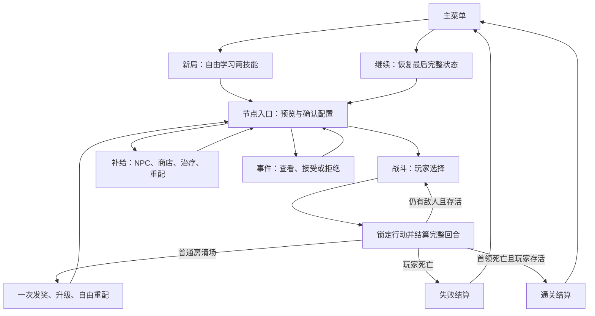

# 整局流程、界面信息与保存

日期：2026-10-26。本文件定义行为合同，不包含游戏代码、最终 UI 图或已经完成的保存功能。保存设计参考 save-systems 技能的方法；具体 Godot 文件实现须在开发阶段核验目标系统。

## 1. 合法状态流



图中 C→D 仅代表恢复的概括入口，**实际继续必须回到保存的战斗／安全／事件／结算状态，不能把战斗退回进房前**。节点编号依 [八节点表](README.md)单向推进；D 不是任意跳关界面。回看路线和图鉴不允许返回旧节点。

|状态|允许|禁止／完成条件|
|---|---|---|
|新局配置|自由学习两项、查看基础规则|未应用合法配置不能开始；可以放弃未开始的新局|
|战斗选择|移动、攻击、技能、稳神、等待、查看、退出|不能学习、重配、买卖；预告不随打开菜单推进|
|回合结算|播放／加速表现、记录日志|不接受新动作；退出请求排队到完整边界|
|清场整理|两物品已入库、经验和钱已到账；加点、重配、降压|重复打开不再发奖；未应用的编辑草稿离开时需应用或放弃|
|补给|三 NPC 服务、自由重配、降压|没有战斗等待或冷却跳过；离开即封闭节点|
|事件|查看与重配，接受或拒绝|未决不能前进；不强制接受|
|死亡／通关|看结果、查看本局构筑、开始新局、回主菜单|不能继续已结束本局或把结果物品领到下一局|

退出和主菜单永远不作为降难度／重新抽奖接口。新局覆盖现有未完成局前必须明确告知将放弃；取消保留原局。首版一个活动局槽位，不添加多个存档选档策略。

## 2. 低保真信息结构

以下是界面内容层级，不是像素布局或最终画风。

```text
生命 24/30  [屏障 5：剩 1 响应]   压力 60/100
透支：生效剩 2 回合  输出×2／承伤×2     房间 N04

[棋盘：单位、格线按需显示、锁地预告形状和响应倒计数]
[选中敌人：生命／本次状态／下一行为规则]

基础攻击 | S1 冷却2 | S2可用 | S3可用 | S4可用
移动／等待／稳神       透支按钮与剩余冷却
瞄准预览：伤害拆项、落点、碰撞、压力变化、超载风险
展开日志：本行动的直接伤害 → 次级伤害 → 防护 → 生命变化
```

显示“敌方预告区域”和“玩家技能区域”必须采用不同轮廓、图标与标签，不只换红绿。多层区域重叠仍能查看来源；不要把次级特效盖住生命和预告。压力 70／100 的刻度及超载 6 损失可直接读到。护盾消耗和生命扣除分开显示，双倍倍率有常驻标识。

```text
清场：经验 +1，等级 3；训练点 +1；残币 +4
新物品 [A 效果／可安装／条件缺失] [B 同类信息]

当前配置：4 技能；每技能符文；3 遗物
编辑区：学习额度、训练点 已用/总量；精修 A/B；返还后的预算
[应用调整] [取消编辑] [打开路径图鉴]

当前压力：可降低     透支：剩余持续／冷却跨房保留
下一节点：内容摘要／事件债务与入场压力预览
[前往下一节点]
```

库存筛选为“新获得／可安装／未满足联动条件／全部”，收藏是防误卖标志，不能改变随机结果。没装备新物品也可继续；不强制每房打开所有物品说明。商店把效果与花费并列，不能只用颜色或稀有度判断强弱。

图鉴每页写“你想做到什么→需要哪些能力→多个基础替代→可选符文→牺牲什么”，不写“法师必须装备四件套”。名字不自动给角色贴职业标签。首版四页无需解锁阅读；收藏构筑快照不在首版，避免误以为可复制掉落。

## 3. 操作与表现提议

2026-10-27用户确认替换旧的二次点击方案：默认左键点相邻敌人普攻、点相邻空格移动；悬停预览，单击直接执行。数字键选择技能后单击目标施放；影袭保留敌人、落点两步。方向键／WASD只移动，不撞敌攻击；按住不连发。当前D1为1／2技能，Space等待、Q稳神、R预约透支、右键地图／Esc取消瞄准和预约。完整暂停仍未实现。

右键战斗技能按钮开启自动施放，以环绕闪烁表示，再次右键关闭；不添加独立按键或图标。自动动作照常独立耗回合且触发敌人响应，按技能槽左到右尝试；无合法有益目标时停止，不自动走路或等待刷冷却。非战斗、模态界面、手动瞄准和手动预约透支时停止；具体启发式与已测边界见[交互精修](../../docs/development/interaction-refinement.md)。

暂停界面查看、音量和退出不耗行动。取消只撤销尚未承诺的选择。高风险动作不每次弹确认，常驻数值预览承担解释；首次透支可用可关闭说明。不可只靠声音提示关键攻击。

动画是规则结果的表现，不改变行动次数或随机数。普通速度和加速必须得到相同结果；首版提供降低屏幕震动、关闭闪白、战斗速度和字体大小选项。键位重设、完整手柄导航列入相应平台体验阶段，在 Steam 宣称手柄支持前必须实际完成测试。

## 4. 保存什么

保存纯数据，不保存场景节点引用。一个版本化活动局记录至少包含：

|组|必要字段|
|---|---|
|身份与版本|存档格式版本、规则内容版本、局编号、快照序号、校验信息、活动／死亡／通关状态|
|随机性|本局种子，奖励／商店／事件各自随机序列当前位置；已生成结果直接保存|
|流程|节点编号、节点状态、已完成房间标志、奖励事务编号、事件选择与债务、下一实体编号|
|角色|坐标、生命、压力、透支持续／冷却剩余数、经验等级、免费学习额度、训练点投入|
|构筑与物品|技能槽及精修、技能冷却、符文／遗物的唯一实例和安装关系、完整库存、金币、收藏标志、历史获得遗物标志|
|战斗|敌人类型、编号、位置、生命、AI 状态、锁定预告坐标、恢复状态、首领循环及召唤已使用标志|
|临时效果|屏障容量／来源／到期、守护、准备效果及期限、火种、E03 使用状态、每施放触发标记|
|服务|每节点库存及售罄、治疗次数、已提交购买／出售／事件事务编号|
|恢复|最近完整状态、已承诺但未结算的行动意图（若有）、足够重放所需的规则版本|

跨局档案只含设置、已读教程／图鉴、通关记录；不继承钱、物品、压力、训练点或基础属性奖励。结束局编号作为去重键，重复恢复结果不能重复累加通关次数。两类文件之间的更新必须可幂等重试，不假定两次写盘天然原子。

## 5. 事务边界与崩溃恢复

战斗的可恢复边界是完整回合结束，不是伤害动画中途。有效行动先将“当前完整快照＋已承诺行动意图”持久化，再执行确定性结算；结束后保存新完整状态并清意图。若崩溃时仍有意图，载入时从该快照重放这次行动，不再让玩家改选、不再次消耗同一奖励。动画不参与重放。禁止把该日志当远程安全或反作弊保证。

购买、出售、治疗、事件选择、奖励发放、应用重配、进入节点都是各自一次事务。相关扣除与获得必须在同一快照中提交。交易按钮成功前等待结果；写盘失败暂停继续推进，提供重试或退出，不在坏状态上继续购买。

拟采用两个轮换的完整快照文件，带递增序号和校验：先把下一快照写到同目录临时文件、完成写入并校验，再替换较旧槽；保留另一个最后有效快照。启动扫描两槽，按序号选择合法版本。具体替换行为与断电耐受须在 macOS／Windows 分别验证，不宣称一个改名调用能保证所有系统不丢数据。

加载流程：检查格式版本和规则版本→需要时迁移副本→校验数量、引用、金币非负、占格、状态合法性→恢复。未知较新版本不覆盖旧文件；提示使用兼容版本。两份均无效时保留原文件，说明无法继续；不能静默新建游戏冒充恢复成功。第一版尚无旧格式迁移代码，但从第一份保存就记录版本。

预期退出结果：

- 战斗选择中退出：回到同一位置、预告、生命、冷却及透支剩余数。
- 结算中请求退出：等完整回合提交再退出；进程被强杀则按已承诺意图恢复。
- 清场发奖中断：物品、钱、经验和房间完成标志同时存在或同时重放，不允许第二次领取。
- 编辑构筑未应用退出：丢弃草稿，恢复上次应用配置；退出前说明有未应用调整。
- 购买中断：恢复交易前或交易后完整状态，不允许只扣钱。重复事务编号无第二次效果。
- 死亡／通关：终局状态先保存再开放结果页；继续按钮不把终局还原成活着的旧局。

## 6. 结果页与诊断信息

玩家结果页只显示关键原因：最后攻击／超载、透支是否生效、防护吸收、最终生命变化，及本局配置和未尝试物品。允许查看更详细行动日志，不用“随机死亡”掩盖已知规则。

开发阶段可另存房间编号、内容版本、种子和行动编号供复现；不把内部事务编号、引擎节点或技术错误堆到常规玩法页面。所有日志与反馈在首版本地保存，不默认上传玩家信息。实际保存、重新启动和多平台故障注入均尚未执行。
