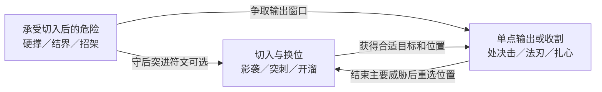

# 白板成长与构筑路径图鉴

> 衔接修订：用户已确认清场后免费重配。首版经验、六点总预算及十技能精修以 [v0.4 成长合同](first-playable/progression-and-economy.md) 为准；下文八类图鉴为扩展参考，首版制作四页。

版本：v0.3，2026-10-26。用户确认：白板人物通过升级、技能加点、符文选择自由塑造能力；基础技能自由学习，稀有改造与符文主要靠掉落；职业与混合职业是构筑结果，路径图鉴供参考。以下具体点数、槽位、技能精修和界面规则均为提议。

## 1. 我们提供能力，玩家形成身份

角色不先选职业，没有法师专属技能树、剑士许可、转职任务和混合职业惩罚。学习护体结界不要求法师等级，学习影袭不要求刺客出身，拿盾也不禁止施法。玩家可以把自己的组合叫作近战法师、肉盾刺客或完全不同的名字。

“白板”指没有预设职业和成长方向，不是开局没有有效行动。默认拥有普通攻击、移动、等待、稳神；另提供两次免费的基础技能学习。玩家可以自行挑选，也可选两个临时入门建议，确认前都能替换。入门建议不作为职业选项，后续可重配。

技能的基础版本都在公共学习目录中。文档中的 24 项构成候选设计池，绝不要求把全部目录一次堆给新玩家：界面先按“近身攻击、远程攻击、防护、位移、控制”筛选，并提供完整目录入口。筛选不会限制可学范围，也不按法师／战士分锁定页。

## 2. 升级、加点、符文、遗物分别负责什么

|层次|来源与去向|玩家决定|边界|
|---|---|---|---|
|等级|完成有限遭遇获得经验，累计达到门槛|何时获得新的成长预算|不要求刷指定武器熟练度；召唤物、重复进房不重复产经验|
|训练点|每次升级获得，投入学习或精修|拓宽能力还是深化核心|所有技能共享一个预算，无物理点／魔法点分账|
|技能精修|在已学技能上投入训练点|改变基础技能的一项取舍|公共、可计划，不依赖抽中指定物品|
|符文与稀有改造|敌人掉落、事件、商店|顺应奖励，强化或改变原有打法|承担随机惊喜；稀有不等于纯数值更高|
|遗物|掉落与交易|选择跨技能的触发规则|不发职业证书、不提供凑齐“法师套”的隐藏奖励|

候选起点：两项技能免费学习；此后 1 点可学习一个基础技能，或精修一个已学技能。每技能最多一项精修，选择两个互斥分支之一；每次精修花 1 点。暂不同时叠加技能等级、属性点、武器熟练度三种预算。

保留 4 主动槽、每技能 2 符文槽、3 遗物槽作为第一轮比较容量。扩充技能池不等于扩充操作栏；四个主动按钮应能表达“输出、保护、接近／离开、控制”之间的搭配和取舍。若混合构筑总被迫删除必要一环，再比较槽位数量，不能先认定四槽已经足够。

## 3. 训练点的可逆性与收益结算

建议只在清场后的安全调整中加点和重配。升级在战中发生时仅提示获得预算，战斗结束后统一处理，保持此前的“清场后调整”决定。

候选规则为：已投入训练点可在安全调整时全部返还，再投入别的技能；免费学习额度同样可重新分配，不绑定最初那两项技能。替换不收手续费。点数不因卸下技能自动丢失，系统显示“总预算／已投入／未投入”；用户明确选择重配才改变投入。

所有战斗增益、护盾、反击准备在清场失效；不能换装或洗点领取治疗，也不能反复学习技能刷经验。冷却按现有草案在清场恢复。生命和压力仍按各自规则结算，升级本身暂不回血，也不默认增加基础生命，避免用加点循环抵消超载。

经验只由房间首次完成等有限目标产生，精英与首领可给更多。第一轮希望整局能够获得约 6 次升级机会，但经验曲线与当前 8–10 场战斗的流程必须一起核算，这不是最终数值。没有等级门槛锁住某个职业技能；难以维持的组合来自点数、槽位与战斗成本，不来自出身。

免费重配的代价是可能每房都抄最优配置。首先观察战后操作负担和是否依赖提前看完整敌人布局；不自动用惩罚费用阻止用户需要的转型自由。下一房只展示主题与危险类型，完整布局信息是否提前提供仍待设计。

## 4. 避免物法双修的双重成本

把三个维度分开：

- **伤害来源：**物理／魔法，用于伤害反馈和明确的组件交互。
- **施放方式：**近身／远程／区域／位移／防护等，一个技能可有多个行为标签。
- **功能：**输出、控制、生存、机动；不是职业分类。

“魔法”不自动等于远程脆皮，“物理”也不自动等于近战。近身法刃、远程投刃与防护法术都从基础目录直接成立。技能按自身基础值和已投入精修发挥，不要求先同时堆力量、智力才有正常伤害。

混合强度来自互相创造条件，例如用护盾保证贴身施法，用位移找到处决目标，用物理攻击准备下次法术。只有把斩击和火球放在一起、却互不影响的配置，也允许存在，但不能把它当作已经实现深度协同。

专精同样应有价值：同样的点数和槽位下，强化一种行为能更稳定解决相应问题；混合获得更广适应性，通常牺牲覆盖范围、爆发窗口或专精深度。既不加入“混职伤害 −20%”，也不默认所有混合配置都应该强于专精。

## 5. 技能精修的具体例子

精修是技能自己的分支，符文是外部改造。第一轮只给重点技能完整分支，其余基础技能先检查用途；24 项目录不等于 48 个精修已经设计完成。

|技能|分支 A|分支 B|需要比较的取舍|
|---|---|---|---|
|S01 火种|射程 +1|直接伤害 +25%，射程 −1|安全距离与近身爆发|
|S09 横扫|攻击扇面扩大到身旁两侧|保持原范围，直接伤害 +25%|覆盖与集中输出|
|S10 突刺|直线接近距离 +1|攻击后获得本次响应守护 3|接近远目标与承受反击|
|S13 法刃|直接伤害 +25%|直接伤害 −20%，命中后获得屏障 4|近身爆发与持续站位|
|S15 护体结界|屏障容量 +50%|容量不变，结束敌方响应后最多保留到下一次响应结束|强承伤与跨行动保护|
|S17 影袭|可选目标距离 +1|落点不邻接其他敌人时，获得本次响应守护 3|进入范围与安全切入|
|S18 处决击|处决生命阈值由 40% 提至 55%|阈值仍 40%，命中未达阈值目标也获得直接伤害 +25%|稳定收割与前置削血|
|S24 卸力步|可移动 2 格，仍不穿单位与墙|只移动 1 格，守护由 3 变为 5|脱离能力与近身承伤|

表中百分比是候选标尺，和现有直接伤害加成合计后再计算，不单独再乘一次。屏障、守护和反击不能把压力超载的生命损失转成可吸收伤害。

## 6. 路径图鉴展示“关系”，不规定职业

图鉴是一份可关闭的构筑参考。它不影响掉落、不授予属性、不阻止装备、不把玩家自动改名为职业，也不提供职业完成度或集齐奖励。

每页包含：想要的战斗体验 → 必需的能力关系 → 多个可替代组件 → 已有组件的关联 → 当前缺少的功能 → 路线的弱点和可转方向。基础说明从开始可查；已遇见的稀有符文显示细节，未遇见者可只显示功能类别，玩家可选择打开完整资料模式。

|参考称呼|能力关系|一个可行示例，不是配方|可替换或转向|
|---|---|---|---|
|魔法师|远程魔法输出＋距离管理＋群体处理|S04 来电、S01 火种、S05 开溜、S07 画地为牢|群攻可由 S14 冰环、S22 地刺替代；减少射程换近身效率可转近战法师|
|剑士|近身物理输出＋接近＋防守或控制|S09 横扫、S10 突刺、S11 招架、S02 甩锅|近身输出可用 S08 扎心；加入 S13 法刃与连携符文可向物法混合转型|
|肉盾|稳定防护＋位置控制＋足以结束战斗的输出|S06 硬撑、S12 盾撞、S03 拉扯、S09 横扫|防护可用 S15 结界；不能只堆减伤让战斗永远打不完|
|刺客|选择单个目标＋接近／脱离＋收割|S17 影袭、S18 处决击、S19 烟幕、S21 投刃|S05 开溜、S10 突刺可替代机动；不要求背刺角度或隐身才能开始玩|
|物法双修|两种伤害主动创造下一次攻击机会|S09 横扫、S04 来电、S10 突刺、S15 结界；可配 R10 连携|R10 增强关系，但不是获得“混合身份”的门票；没有它也可用控制和位置衔接|
|肉盾法师|防护维持施法位置，施法补充承伤能力|S15 结界、S16 虹吸魔弹、S14 冰环、S04 来电|可用 S06 替换结界，R12 施法成盾增加另一条保护来源|
|近战法师|接近目标＋近距离魔法输出＋撤离或保护|S13 法刃、S14 冰环、S05 开溜、S15 结界|R13 贴身施法使原本远程技能也适合近身，不只靠一个指定法刃|
|肉盾刺客|有保护的切入＋定点爆发＋再次换位|S17 影袭、S18 处决击、S06 硬撑、S24 卸力步|可以用 S15 结界替换硬撑、S10 突刺替换影袭；防护不能自动补足群攻弱点|

这些名称服务理解，不用于排他分类。同一个角色可以同时符合“近战法师”和“肉盾法师”，也可以不符合任何已有页面。允许玩家给当前构筑自命名、保存参考快照；快照只记录组成和说明，不复制本局掉落、不跨局赠送属性。

例如“肉盾刺客”页面可以显示下面这张关系图。连线表示互相支持，不是必须按顺序执行的连招；一项技能也可以兼顾两个功能。

选中连线时先解释作用，再列对应技能、精修与符文；没有稀有组件时仍展示基础替代。参考页不承诺“采用任意三个名字就一定强”，完整配置还需检查冷却、覆盖、生存与输出之间的取舍。

## 7. 同一白板如何走出不同结果：纸面示例

假定两次免费学习选 S09 横扫、S05 开溜。随后获得两点训练预算：

- 路线一学 S11 招架与 S10 突刺，形成接近、挥砍、防守、撤离的剑士式能力。
- 路线二学 S13 法刃与 S15 结界；拿到近身魔法符文后，把横扫的免费学习额度重配到 S14 冰环，形成近战法师式能力。
- 路线三学 S17 影袭与 S06 硬撑；以后把横扫额度改学 S18 处决击，保留一项撤离能力，形成肉盾刺客式能力。

三条都使用同一个点数与槽位规则。变化发生在安全调整时，点数返还与重新投入同屏显示；没有转职界面或职业等级。这里只检查构成是否能表达意图，没有证明三条在相同遭遇下已经平衡。

## 8. 本轮要反证的问题

能力关系式图鉴是否让玩家理解为什么搭配、愿意替换组件，而不是更依赖官方配方？未来应在相同技能、奖励与说明下比较“固定完整配方页”和“关系＋替代项页”；只改变图鉴表达，观察缺少一个示例组件时是否仍能继续构筑。

若玩家仍只追求指定组合，或理解关系却发现替代技能实际无效，就不能声称图鉴解决了自由度。弱点可能来自表达，也可能来自技能池本身；两者需分开修。结构化假设见 [构筑图鉴假设](build-atlas-hypothesis.json)。
