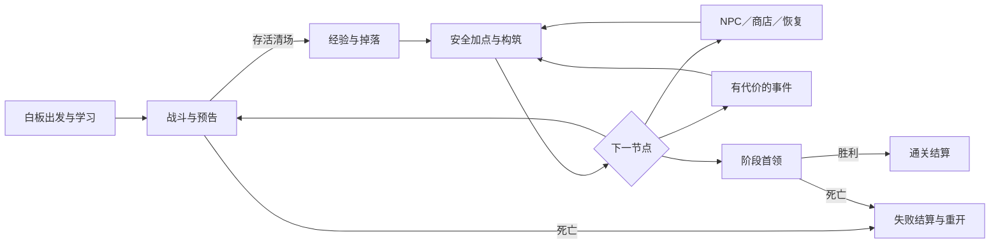

# 系统完整性核查与补齐方案

> 后续补齐：本报告保留补齐前的审计状态。A–E 已形成 [v0.4 首版规格](first-playable/README.md)，包含敌人卡、逐节点经济、NPC 交易、完整流程与验收条件；当前为待评审文档，不代表开发或实机验收通过。最新任务状态见 [roadmap](roadmap.md)。

日期：2026-10-26。核查对象：仓库 design 下现有产品、成长、技能、战斗、房间、美术、规划与假设文档；研究目录仅用于追溯。所有结论是文档审计与纸面推理，没有游戏运行或玩家测试。

## 1. 修正后的结论

**当前有清楚的产品方向和若干规则草案，但还没有一套能支持完整首版开发的设计闭环。敌人、NPC、商店与经济确实缺失关键内容，不能仅归为“以后补”。**

上一份启动评审偏重“能否做战斗灰盒”，遗漏了产品范围的系统覆盖。这份补充将“局部验证可以开始准备”和“完整首版具备开发规格”分开；前者不能证明后者。尤其商店会改变奖励价值和治疗成本，NPC会改变服务可达性与跨房资源，敌人决定构筑实际用途，它们都会反过来影响核心玩法。

状态口径：**方向明确**是用户选定目标；**局部规则**表示某些场景可判定，但模块仍不能独立实现；**概念**只有职责或例子；**缺失**表示当前仓库没有可执行规格。未在文档中找到的内容不等于用户已决定删掉。

## 2. 全系统覆盖表

P0：完整首版开发基线前必须给出规则或明确裁剪；P1：相应模块编码前补齐；P2：验证核心后再扩充。P0 不要求最终数值完美，而要求结果可判定、范围可实施。

|系统|现状与证据|实质缺口|优先级与补齐产物|
|---|---|---|---|
|定位与平台|方向明确：[产品](README.md)|目标操作系统、首版目标设备、一次试玩想验证什么未锁定|P0：范围和目标设备表；macOS 开发机不自动代表发行目标|
|整局状态与路线|概念：[房间](run-and-encounters.md)有两章和节点|开始、进房、清场、升级、服务、转场、死亡、通关之间的合法转换；返回和重复进入|P0：完整状态流及各阶段持久资源|
|回合推进|局部规则：[战斗](combat-and-pressure.md)有一步一响应|锁定动作、输入防重、敌人顺序、结束检查、动画跳过的语义|P0：唯一回合结算合同|
|空间规则|局部规则：四方向、距离、推拉|视线与墙角、穿透、落点、单位占格、路径同距、出生安全区|P0：坐标例图与合法／非法行动表|
|伤害与状态|局部规则：[技能](builds-and-loot.md)有公式与防护|死亡后续效果、普通攻击标签、状态刷新／到期、伤害归属、首领转换的统一边界|P0：伤害事件和状态规则表|
|压力|局部规则但有冲突：[启动评审](development-readiness-review.md) R1|低压透支可能无代价；战后免费降压与跨房压力设计不一致|P0：收益代价修订及三个可解释局面|
|成长与技能点|局部规则：[成长](progression-and-atlas.md)|经验曲线、精修覆盖、点数上限、洗点与学习自由的关系、开局最差组合|P0：逐房成长预算；自由学习不等于已确认免费无限洗点|
|技能与符文|候选目录较多|24 技能中仅 8 项有精修分支；交互优先级、兼容与无效组合提示不全|P0 选首版清单；P1 补所选技能卡和交互案例，不先补全所有候选|
|普通敌人行为|概念偏局部：[房间](run-and-encounters.md)有四种职责|生命伤害、完整状态循环、射程、目标选择、阻挡、被推拉／定身后的行为|P0：至少三张完整敌人卡|
|遭遇组合与难度|概念：三种布局|各房组合预算、开场位置、危险叠加上限、控制构筑解法、逐房强度和奖励|P0：至少三个逐回合可推演遭遇；P1 扩首版房间|
|精英与首领|概念：督办与画饼主教|完整招式循环、准备与恢复、召唤上限、固定躯体、奖励和胜负触发|P0：首版终点检验是否需要首领；如需要至少一张可执行首领卡|
|友好 NPC|缺失正式设计|角色职责、出现地点、可交互时机、服务、一次性状态、离开与重访、剧情信息|P0：首版 NPC 职责和交互表；P2 扩背景故事与复杂关系|
|商店与经济|概念：[房间](run-and-encounters.md)一段补给，[技能](builds-and-loot.md)一段回收|货币收入、价格、库存、刷新、出售、撤销、买回、售罄、治疗和服务的机会成本|P0：可算账的一章经济表与交易规则|
|掉落与稀有度|局部规则：频繁掉落与适配建议|完整奖励池、权重、保证顺序、重复与池耗尽回退；稀有改造是否独立品类|P0：首版池和一次真实序列；P1 概率表|
|背包与装备|局部规则：槽位和战后调整|实体归属、绑定／解除、满槽替换、预览与确认、回收撤销及收藏行为|P1：交易前后资产守恒示例与界面状态|
|休息与恢复|概念：免费恢复部分生命|恢复量、次数、是否花钱、与商店／事件冲突、是否清状态、能否反复进入|P0：恢复合同，须与压力和经济一起设计|
|事件与对话|概念：一个“自愿加班”|触发条件、选项可见结果、延迟代价、取消、重访、存档，是否必须战斗后生效|P0 定首版用途；P1 至少一张完整事件卡|
|图鉴与教学|结构草案较完整|首局实际操作引导、首次升级／掉落／透支说明、信息开放范围、替代项有效性|P1：首局引导和两张可用参考卡；完整图鉴不阻塞战斗灰盒|
|HUD／菜单／输入|概念：[美术](world-and-art.md)描述布局|技能瞄准、取消、按住／连点、界面焦点、暂停、商店操作、缩放和提示遮挡|P0 基本输入合同；P1 低保真全流程界面|
|保存／恢复／死亡|仅原则：本局死亡结束构筑|存档时点、继续游戏、掉落／库存是否固定、交易重读、退出、坏档、版本变化|P0 决定首版是否持久保存及其边界；P1 在相应模块前给数据合同|
|局外进度|概念：[房间](run-and-encounters.md)提到解锁起始组合|是否与全部基础技能自由学冲突、解锁池稀释、永久属性是否存在|P0 给首版明确“无局外增益”等范围提议；不得默认为完整系统已有方案|
|随机与地图生成|缺失生成规格，有固定布局意图|随机对象、种子、重入不重抽、路径可达、风险公平|P0 定首版固定地图＋可重现奖励是否采用；P2 程序地图算法|
|美术／音频／素材|方向与 brief 已有|具体画法、样品、动画家族、UI图标、中文字体、来源与许可、声音强弱层级|灰盒允许占位；P1 代表性素材与反馈；正式批量生产前必须验收|
|工程／验证／发行|引擎版本已核验，Git 已有|工程结构、状态与表现分离、内容编辑约定、规则测试、窗口试玩、导出和目标系统验证|P0 技术基线；P1 运行／导出；发行事务后置，但不能把引擎可执行当项目测试通过|

不能从表的行数算“完成百分比”。一个未定的死亡或交易规则可能影响多个系统，而几十个已命名技能并不能抵消它。

## 3. 敌人要补到什么程度

名称和攻击风格不够。每张敌人卡至少要包含：定位、出现阶段、生命／伤害、空间尺寸、每响应动作、完整循环、目标与路径优先级、预告、被打断后的状态、状态抗性、奖励归属以及与其他敌人的组合限制。

以下是**补齐规格的例子，不是已批准敌人参数**，用于显示此前缺了哪一层。

|字段|抬杠者候选规格|
|---|---|
|职责与暂定标尺|逼迫玩家离开直线；生命 18、重击 8；这些值必须与玩家初始生命一起核算|
|判断|未处于蓄力时，玩家在同一行／列、距离不超过 3 且无遮挡，则本次响应仅准备重击；否则沿合法最短路径靠近 1 格|
|准备|记录本格和朝向，显示前方 3 格地面危险；进入下一次玩家行动|
|执行|下次敌方响应击中原锁定格内目标，不重新追踪；目标已经离开也照常落空|
|打断|准备期间被强制位移，则取消锁定并显示中断；其接下来的一次响应只恢复，不能立刻重新蓄力或攻击|
|定身|不禁止已有重击执行，只禁止主动移动；被推拉仍可打断|
|落空／命中后|下一次敌方响应恢复，再进入判断；恢复时不移动、不攻击|
|阻挡|移动路径被占且没有同长合法备选时等待，不穿人；同距顺序必须全局一致|
|组合约束|首个教学房只有一个抬杠者，避免多个交叉预告同时覆盖所有可达安全格；后续可增加但必须检查可应对窗口|
|发奖|房间完成产生一次经验与房间奖励，不由反复召唤／重入复制|

还需要跟风者、传话筒等完整卡，以及一张首领卡。应分别安排独立教学、与追击者组合、两种危险同时存在的遭遇。不能以“首领免疫控制”回避推拉／定身的设计，也不能让所有控制都变成同一种额外伤害而失去行为差异。

## 4. NPC 应进入主循环，而不是最后补几句对白

建议首先确定 NPC 在局内安全节点提供什么服务、玩家能否离开、服务次数和持久状态。角色名字与立绘可以晚于服务合同，功能不能晚于经济与成长。

下列为三种**候选职责**，不等于要制作三个大型剧情系统：

|候选角色|玩家作用|出现与状态提议|不能暗中改变的规则|
|---|---|---|---|
|旧物贩子|购买符文／遗物，回收不需要的组件|每章固定一次安全节点；库存首次进入生成，本局保存，重开面板不刷新|不出售基础技能学习资格，不把稀有商品当职业许可证|
|缝补匠|把有限资源转成生命恢复，提供保命与补强的取舍|可与商人同节点；一次有限服务，已用标记保留|疗愈不能无限循环，不能在每次对话开始时自动回血|
|记路人|解释地牢规则、查看路径图鉴和已知风险|安全节点或界面入口；帮助可重复查看，不耗行动／货币|不收取技能解锁费，不替玩家选职业，不因看了图鉴而改变奖励池|

候选共同交互：进入安全节点 → 选择交谈／交易／服务 → 预览代价和结果 → 确认一次 → 更新角色与节点状态 → 返回节点或离开。取消不消耗资源。不能在后台继续敌人响应。

NPC 是否可攻击、死亡、带关系或跨局任务当前未决定；首版建议不开放这些行为，并明确写入范围，不能由程序员自行实现“任何单位都可攻击”。后续若加入救援 NPC，必须写出失败、救出、后续出现与服务变化的状态，而不是只加对话。

## 5. 商店与经济需要一张能算账的表

原“有钱可以买物品”无法指导开发。需要一起确定：收入、存量、消费、回收、价格、库存和刷新。购买回血会改变压力风险，出售掉落会改变频繁掉落的价值；这不是独立 UI 模块。

**候选最小规则：**残币为唯一局内货币；普通房给固定底薪加少量可重现浮动，精英更多；商品为符文／遗物，基础技能仍从训练预算自由学习。库存首次进入确定，离开再返回不刷新；首版先不做付费刷新与买回。恢复服务每节点一次。是否允许返回上一节点，须在路线合同确定，不能靠反复进出刷服务。

**用于核算的示例，不是价格定案：**

|项目|示例值|
|---|---:|
|起始残币|0|
|普通房收入|4|
|精英房收入|8|
|回收一个普通无用组件|2|
|普通符文售价|6|
|稀有改造或遗物售价|10|
|单次恢复 6 点生命|6|

经过两普通房有 8 币；回收两件不需要的组件后有 12 币。此时可以买一个稀有改造剩 2，也可以买普通符文并恢复生命；全部都买不起，产生清楚的取舍。如果后续治疗能廉价抵消透支损失，则要同时改压力和治疗价格，不能单独调高怪物血量掩盖。

交易必须补这些边界：余额不足、物品已售罄、已买物品放入背包还是自动装备、关窗口后库存状态、收藏防误卖、回收后已花币是否允许撤销、买下再卖出有无套利、读档是否重复发货。建议“购买仅入背包，清场安全阶段明确装配”；钱和物品在同一次确认内变化，不能一个保存成功、另一个失败。

完整经济表至少列出低收益／正常收益／高收益三种路径，以及不卖物品、卖多数物品两种行为，检查能买几次、是否每局必买同一件、是否出现无钱且无可用选择的长段落。

## 6. 战斗逻辑不能只是一条六步流程

需要把目前分散在战斗和技能文件中的约定汇成一套结算表，覆盖以下阶段：

1. **行动资格与预览：**目标是否合法、消耗是什么、取消或无效输入怎样处理；预览不能改变随机状态。
2. **行动提交：**一次提交只扣一次成本，动画未结束时不能叠加输入；记录直接伤害加成取值时点。
3. **主动效果：**各子效果顺序、直接命中与次级命中、位移／碰撞／状态的先后；明确零生命单位何时移除。
4. **触发链：**哪些事件能触发哪些组件、一次的范围是“释放／玩家行动／敌方响应／整个回合”中的哪一个；禁止的递归必须可解释。
5. **敌方响应：**稳定顺序、死亡／被控过滤、准备／执行／恢复；控制不等于全部敌人跳过。
6. **时限与资源：**冷却、屏障、定身、地面区域与准备增益的计时依据；状态施加当轮是否计时。
7. **终止与奖励：**超载、双方死亡、清场、掉落、经验升级与安全调整的唯一切换点。

必须给预期结果的例子包括：致死推击后是否还有爆炸；两个击杀是否只触发一次遗物；招架反击杀死后续敌人是否取消其行动；定身敌人是否仍能出手；同一次攻击同时破盾与触发生命伤害；最后一击超载死亡；清场获得升级但角色已死亡。当前文本并未完整覆盖这些情况。

第一版不必引入随机命中、随机暴击、元素抗性表和复杂护甲公式；若不做应明确写“不在首版范围”，不能用“以后可能需要”留下隐式规则。

## 7. 全流程必须连接起来

以下流程是**需共同收敛的首个完整试玩版候选**，不是已确认产品规则。它比纯战斗灰盒多出 NPC 服务和经济节点，这些不能从完整试玩版范围里随意删除。

存档需要保存的是这个流程中的状态：生命、压力、学习预算与投入、符文实体和绑定、货币、房间完成标记、商店库存与已购记录、NPC服务次数、事件延迟效果和随机状态。否则重读同一节点可能改变商品或重复领奖。战斗灰盒可以先不支持继续游戏，但对外完整试玩必须明确是否保存及退出的损失。

局外解锁也必须和自由学习原则对齐。当前“解锁起始组合”的旧候选不应成为基础技能的门槛；首版建议不加入永久数值，图鉴记录与个人参考配置可以保留。是否采用仍需确认。

## 8. 补齐顺序与交付标准

|优先工作包|要完成的具体内容|完成证据|
|---|---|---|
|A 战斗＋敌人＋遭遇|统一结算表、三个完整普通敌人卡、一个首领卡、三个带坐标和数值的遭遇|用不同基础配置走完逐回合推演，关键状态都有唯一结果|
|B 成长＋掉落＋经济|逐房经验／点数、首版技能精修、奖励池与回退、一章收入与消费表|两条不同成长路径可形成能力；正常／低收益路径能解释买、留、卖的取舍|
|C NPC＋商店＋事件|至少一个商人和一种恢复服务的状态合同、一项事件、出现与离开规则|从初访、交易／拒绝、离开、重返到保存恢复的结果可判定，不重复领取|
|D 全流程＋界面＋存档|开局至失败／通关的状态图、战后调整与交易的低保真页面、持久状态清单|纸面走查不会卡在未定义页面、未发放奖励或未知退出后果|
|E 首版实施与验收|冻结选入技能／敌人／节点，临时美术、输入、Godot工程与导出计划|能明确每阶段做什么、如何验、哪些明确不做；不能用全部候选目录替代开发范围|

A 与 B 需要反复对齐；C 不是在它们全部写完后才考虑，因为治疗和商店直接影响 B 与压力。D 负责把这些内容连成产品。没有明确拆分这些依赖，就会在编码中不断推翻接口与数值。

完成这些工作包的首版范围后，即可进入开发和实际验证；不要求所有正式台词、全部怪物种类或终局平衡预先定死。**目前这些工作包尚未完成，不能标记“设计准备已充分”。**
